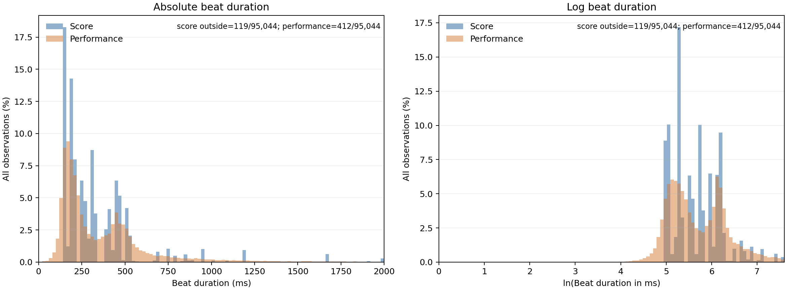
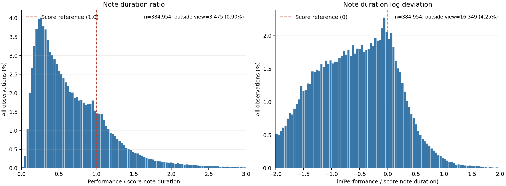

# 基于 Beat 的双级时间表示设计

## 1. 设计动机

当前逐音符时间目标用相邻音符或起音组之间的 IOI 表示时间。这样同一组和弦中的音符需要特殊的零 IOI 规则，而下一个起音组的时间还可能依赖音符排序。当前 score MIDI 在和弦内按音高排序，因此最低音可能意外地成为时间参照。

新设计把 score 的节拍结构显式加入输入，并让 BEAT 同时承担 beat-duration 输出：**BEAT token 提供 score beat 网格、score beat duration 和小节起始标记，并在 beat 状态上预测 performance beat duration**；**NOTE token 预测演奏音符属性**。note onset 相对所属 performance beat 起点表示；弱起、切分或演奏提前都可能令它为负，因此比例必须允许负值，也不应硬限制在 `[0, 1]`。

## 2. 双级表示

记 `b` 为 score 中的拍编号，`T0_b` 为 score 中该拍的标准时长（毫秒），`B_b` 为演奏中按确定性规则选出的拍点时间。

每个 BEAT token 表示一个 score beat。输入的 `score_duration` 是当前 score beat 到下一个 score beat 的 score 时长；对应的输出目标是 performance beat duration。它不是相邻音符的 IOI。

每个拍 token 对应从当前拍点到下一拍点的间隔：

$$
r_b^{\mathrm{beat}} = \frac{B_{b+1}-B_b}{T^0_b},\qquad r_b^{\mathrm{beat}}>0.
$$

`r=1` 表示 performance beat 时长等于 score beat 时长，`r>1` 表示放慢，`r<1` 表示加快。模型可以预测 `ln(r)` 或 ratio 的离散 token；输入的 score beat duration 仍可编码为 `ln(T^0_b)`。

**二级：NOTE token 相对所属拍起点的起音比例。**

音符 `i` 属于 score 拍 `b_i`，其演奏起音为 `t_i`：

$$
u_i^{\mathrm{note}} = \frac{t_i-B_{b_i}}{B_{b_i+1}-B_{b_i}},\qquad
t_i=B_{b_i}+u_i^{\mathrm{note}}(B_{b_i+1}-B_{b_i}).
$$

其中 `B_b` 是模型还原出的 performance beat 起点。`u=0.10` 表示拍点后 10% performance beat duration，`u=-0.05` 表示早 5%，`u=1.10` 表示落在下一 beat 起点之后 10%，但音符仍按 score 对齐关系归属原 beat。`u` 是 note 相对 performance beat 的位置。

## 3. 双级比例统计（onset-group 均值与线性插值）

拍不是从演奏音符里挑一个“第一个音”。理论上的拍网格应由 score 的小节线、拍号和拍内分组确定：例如 4/4 通常以四分音符为拍，6/8 通常以附点四分音符为复合拍。即使该拍没有音符，beat token 仍存在；休止拍也不能删除，否则 score beat 的时间轴会断掉。

本次统计覆盖 19 首 ASAP test 乐曲、384,954 个对齐演奏音符。拍网格由 score MIDI 的拍号确定；performance beat 不使用独立 beat 标注，而按以下确定性规则映射：先把 score onset 相同的音符合并成 onset group，取组内配对 performance onset 的算术均值作为该组时间；score beat 边界恰好命中 onset group 时取组均值，否则仅在相邻已观测 onset group 之间做线性插值。首末 onset group 以外不外推；不做 tempo 阈值过滤，也不做单调性过滤。只有两个 beat 边界都有观测范围支持，且映射后的 beat duration 为正时，该 beat interval 才纳入 beat/onset 统计。

该规则不按音高选择和弦锚点，也不要求组内音符按低到高排列。组均值会压缩和弦内部的滚奏差异；局部反向 onset group 不会被删掉，而会使跨越它的非正 beat interval 不可用。note-level dev 因而仍包含组内滚奏与对齐误差，但不会把 unsupported 的外推 beat 当成有效测量。

### 3.1 Beat duration

这里的 `beat duration` 明确定义为**当前 beat anchor 到下一个 beat anchor 的时间间距**。性能侧使用相邻新映射 beat anchors 的差，score 侧使用相邻 score beat ticks 按 score tempo 换算出的时长。它不是 note-to-note IOI。

| 统计量 | 比例 |
|---|---:|
| Beat duration 样本数 | 95,044 |
| 均值 / 中位数 | 1.094 / 1.018 |
| 5 / 25 / 75 / 95 分位数 | 0.594 / 0.895 / 1.195 / 1.799 |
| `[0, 1]` | 45.64% |
| `>1` | 54.36% |

这里大于 1 代表实际拍间时长长于 score 标准拍时长，也就是该拍局部较慢；小于 1 则较快。`r` 严格来说不会小于等于零。统计中位数略高于 1，反映该批 test 性能的估计拍长总体略长于 score 时值。

对训练目标而言，ratio 的对数更合适：`ln(r)=0` 是不偏离 score tempo，正值是放慢，负值是加快。当前 `ln(r)` 的均值/中位数为 `0.032/0.018`，5/95 分位数为 `-0.520/0.587`。

下面比较 score 和 performance 的绝对 beat duration 以及其自然对数。两边按各自样本数归一化，log 图使用 `ln(duration in ms)`。

| 统计量 | Score beat duration | Performance beat duration |
|---|---:|---:|
| 样本数 | 95,044 | 95,044 |
| 均值 / 中位数（ms） | 337.790 / 267.857 | 372.354 / 259.799 |
| 5 / 95 分位数（ms） | 150.000 / 750.000 | 129.802 / 940.642 |
| 均值 / 中位数（ln ms） | 5.658 / 5.590 | 5.690 / 5.560 |




### 3.2 Note-token onset / 实际局部拍长

这里同时报告 score 与 performance 两侧的 note onset。Score onset 是音符相对所属 score beat 起点的固定比例：

$$
u_i^{\mathrm{score}}=\frac{s_i-S_{b_i}}{S_{b_i+1}-S_{b_i}},
$$

其中 $s_i$ 是 score note 起点，$S_b$ 是 score beat 网格起点。因此 score onset 理论上位于 $[0,1)$；它描述乐谱中的拍内位置，不是演奏偏移。Performance onset 则使用前文的 performance beat anchor 和实际 beat duration 计算，二者的差异才包含演奏时序偏移、和弦滚奏和 beat 映射误差。

为了把拍内位置与演奏偏移分开，再定义 onset deviation：

$$
d_i^{\mathrm{onset}}=u_i^{\mathrm{perf}}-u_i^{\mathrm{score}}.
$$

$d=0$ 表示演奏起音位于乐谱预期的同一拍内位置；$d>0$ 表示相对 score 拍内位置延后，$d<0$ 表示提前。这里的 dev 是比例坐标之差，不是 duration 的对数偏差。

| 统计量 | 比例 |
|---|---:|
| Note onset 有效样本数 | 384,559 / 384,954（99.90%）|
| Score note onset 均值 / 中位数 | 0.217 / 0.000 |
| Score note onset 1 / 5 / 95 / 99 分位数 | 0.000 / 0.000 / 0.750 / 0.833 |
| Score note onset 在 `[0,1]` | 100.00% |
| Score note onset 恰为 0 | 57.89% |
| Onset deviation 均值 / 中位数 | -0.0035 / 0.000 |
| Onset deviation 1 / 5 / 95 / 99 分位数 | -0.254 / -0.117 / 0.106 / 0.227 |
| Onset deviation 小于 0 | 47.80% |
| Onset deviation 恰为 0 | 8.87% |
| 早于估计拍点 | 95,267（24.77%）|
| 与估计拍点重合 | 8.40% |
| 位于 `[0, 1]` 当前拍范围 | 75.22% |
| 晚于下一拍边界（`>1`） | 0.0099%（38 个音符）|
| performance onset ratio 中位数 | 0.040 |
| performance onset ratio 5 / 95 分位数 | -0.061 / 0.747 |
| performance onset ratio 1 / 99 分位数 | -0.174 / 0.861 |

负值的幅度并不都很大。按实际局部拍长分箱，`-1%–0%` 有 **7.07%**，`-10%–-1%` 有 **15.11%**，`-25%–-10%` 有 **2.08%**，小于 `-25%` 有 **0.51%**；零点占 **8.40%**。其中 performance onset ratio 小于 0 的比例为 24.77%，与 onset deviation 小于 0（47.80%）不同：后者还减去了 score 中原有的拍内位置。

按区间查看，下面的比例均以全部音符为分母；`0–10%` 区间包含恰好位于拍点的音符：

| Note onset 比例区间 | 音符比例 |
|---|---:|
| `<0` | 24.77% |
| `0–10%` | 30.90% |
| `10–25%` | 6.52% |
| `25–50%` | 15.85% |
| `50–75%` | 17.21% |
| `75–100%` | 4.71% |
| `100–125%` | 0.0119% |
| `>125%` | 0.0018% |


下面把 score note onset 与 performance note onset 放在同一张图中。两者使用相同的 beat 内比例坐标，但 performance 分布允许小于 0 或略大于 1；score 分布则由 score 网格约束在 `[0,1)`。


负值表示 note 起音早于按 onset-group 均值映射出的该拍边界，不表示 MIDI 无效。正值大多落在当前拍内。图中横轴裁切在 note `[-1,2]`、beat `[0,3]`；被裁切样本数会标在图内，精确数据保存在统计 JSON 中。performance onset ratio 超过 1 的比例为 38/384,559。

`u<0` 表示 note 起音早于按 onset-group 均值映射出的所属 score beat 边界；`u>1` 表示它晚于下一拍边界。这些值是**未环绕的连续拍坐标**，不是限制在单拍内的相位角。大于 1 不会自动把音符重新归入下一拍，因为 note 仍按 score 对齐关系归属原拍。负值还包含同一 score onset group 内的和弦滚奏差异。

### 3.3 Note onset 范围建议

不要把 onset 强制限制在 `[0,1]`：performance onset ratio 约 24.77% 小于 0。首轮实验把 `[-0.25,1]` 均匀划分为 500 个 token，区间外值裁到最近端点并记录裁剪比例。performance onset ratio 的 1%–99% 分位数为 `[-0.174,0.861]`，落在建议区间内；实际端点裁剪比例仍应直接按 ratio 标签统计，不能从 onset deviation 的分布代替。

### 3.4 用新映射重算 1112 代表实验

1112 的 `separate_timestep_abs5000` 与 `pure_coord_mlp64` 使用同一 beat 映射和同一套四项指标重新评估，训练 checkpoint、生成 MIDI 和三轮 sampling 均未改变。它们与本轮 1115 设置的结果统一列在 [exp1115 四项指标表](exp1115_BEAT.md#4-四项-score-event-指标)，避免拆成不同评估表。

四项指标的坐标为：onset 使用 `u_perf-u_score` 的 beat-ratio dev，duration 使用 `ln(D_perf/D_score)`，velocity 使用原始 MIDI velocity；W1 在每个 score note 上逐一比较预测值与同一 note 的人类参考值，再对 note 和作品宏平均。因为 onset ratio 与 dev 对同一 note 只是共同平移，二者的 PN W1 应一致。

有效 beat interval 覆盖率按每个 score event 计算，两个方法的三轮平均约为 `99.8%`（各作品范围约 `99.5%–100.0%`）。少量 unsupported interval 被排除，不通过端点外推补齐。

## 4. Duration 统计

duration 以逐音符对齐的 score/performance 时值计算。定义时值比例和自然对数偏差：

$$
q_i^{\mathrm{dur}}=\frac{D_i^{\mathrm{perf}}}{D_i^{\mathrm{score}}},\qquad
d_i^{\mathrm{dur}}=\ln(q_i^{\mathrm{dur}}).
$$

`q=1` 或 `d=0` 表示演奏时值等于 score；负的 log deviation 表示演奏时值较短，正值表示较长。log deviation 将“缩短一半”和“延长一倍”表示为相反数（`-ln 2` 和 `+ln 2`）。

| 统计量 | Duration ratio | Duration log deviation |
|---|---:|---:|
| 样本数 | 384,954 | 384,954 |
| 均值 / 中位数 | 0.716 / 0.559 | -0.628 / -0.582 |
| 5 / 95 分位数 | 0.144 / 1.703 | -1.935 / 0.533 |
| 小于 score 时值 | 77.66% | 77.66%（`d<0`）|
| 大于 score 时值 | 22.19% | 22.19%（`d>0`）|

ratio 图横轴显示 `[0,3]`，log deviation 图显示 `[-2,2]`；图内标注了视野外样本数，完整极值见统计 JSON。

下面分别叠加 score 和 performance 的绝对时值分布、自然对数时值分布。为便于比较，两类直方图分别按各自样本数归一化；log 图使用 `ln(duration in ms)`，横轴平移单位不会影响分布形状。




## 5. Beat duration 与 note duration 的统一数值设计

BEAT 输入中的 score beat duration、BEAT 输出中的 performance beat duration、NOTE 输入中的 score note duration 和 NOTE 输出中的 performance note duration 都是正值时长，可以采用统一的 absolute-log 或 score-relative log-dev 数值设计。输入 embedding 仍使用 score-side absolute-log，输出 head 分别预测 beat 与 note 的 performance duration。

可以比较以下两个统一协议。绝对 log duration 使用自然对数毫秒值 `ln(D_ms)`。两种 duration 输出都使用 500 个数值 token；note onset 也固定使用 500 个数值 token，区间为 `[-0.25,1]`。

| 协议 | encoder 输入 | decoder 历史输入 | beat/note 输出目标 | 建议主体区间 |
|---|---|---|---|---|
| Absolute-log | `ln(D_score)`，包括 beat 和 note duration | `ln(D_perf_previous)` | `ln(D_perf)` | `[3,8]` |
| Score-relative log-dev | `ln(D_score)`，包括 beat 和 note duration | `ln(D_perf_previous)` | `ln(D_perf)-ln(D_score)` | `[-2,3]` |

Absolute-log 的优点是 encoder、decoder 输入和 duration 输出处于完全相同的语义空间，输出可以直接量化后回馈给下一步 decoder。Score-relative log-dev 的优点是输出只表达相对于 score duration 的演奏偏差，减少曲目速度和时值本身的变化；但它的输出不能直接作为下一步 decoder 的输入。生成时应先还原：

$$
\ln D^{\mathrm{perf}}_i
=\ln D^{\mathrm{score}}_i+d_i^{\mathrm{dur}},
\qquad
D^{\mathrm{perf}}_i=\exp\left(\ln D^{\mathrm{score}}_i+d_i^{\mathrm{dur}}\right),
$$

再把还原后的 `ln(D_perf)` 量化并作为历史 decoder 输入。beat head 和 note duration head 都可以使用同一还原公式；beat head 的输出用于累积得到 `B_b`，note onset 再相对这些 beat anchors 计算。

首轮协议严格使用 500 个 bins：`[3,8]`、`[-2,3]` 和 `[-0.25,1]` 均匀分箱，区间外样本裁到最近端点。裁剪比例必须单独记录；后续可以增加 tail-token 版本，但不与首轮 500-token 结果混合比较。

输入的 absolute-log 时长词表可以采用两种消融：

1. **Shared duration value table**：beat duration 与 note duration 共用一张数值 embedding 表，使用类型/slot projection 区分上下文。
2. **Separate duration value tables**：两者使用独立表，参数量增加但不会强迫两种 duration 共享 embedding 几何。

score/performance absolute-log 输入词表可以在 beat 与 note duration 之间 shared 或 separate。若使用 log-dev 输出，其输出 token 表表示偏差，应与 absolute-log 输入表 separate；shared/separate 以及 absolute-log/log-dev 都应通过相同训练协议进行消融。

统计协议、分位数和逐曲目结果见 [`../analysis/design1115_beat_stats.json`](../analysis/design1115_beat_stats.json)，可由 [`../../script/analyze_beat_relative_onsets.py`](../../script/analyze_beat_relative_onsets.py) 重算。统计 JSON 不放在 `docs/`；统计脚本和离线评估共用 [`../src/data_process/beat_mapping.py`](../src/data_process/beat_mapping.py) 中的 onset-group 均值映射实现。

## 6. Token 与解码结构

不额外使用 `BAR` token。小节边界直接编码为 beat 的二值属性 `measure_start`，因此 encoder 输入和 decoder 目标序列都包含 beat 和 note 两种事件：

```text
BEAT(score_duration, measure_start)
NOTE(pitch, score_duration, score_onset, score_velocity)
NOTE(...)
BEAT(score_duration, measure_start)
NOTE(...)
...
```

两类事件使用不同的属性组合，但都采用属性 embedding 相加。BEAT 本身由专用的 `beat embedding` 表示；有 `measure_start` 时这张表有两个 token，无区分时只有一个 token，不再额外叠加独立的 `e_beat`：

$$
h^{\mathrm{beat}}=E_{\mathrm{beat}}[m]+e_{\mathrm{score\_duration}},
$$

$$
h^{\mathrm{note}}=e_{\mathrm{pitch}}+e_{\mathrm{score\_duration}}+e_{\mathrm{score\_onset}}+e_{\mathrm{score\_velocity}}.
$$

事件类型仍保存在每个事件的显式 type 字段中，并用于 attention、mask 和输出路由；但 BEAT 的输入身份由 `beat embedding` 承担，不能再叠加另一份独立的 BEAT type 向量。NOTE 使用 NOTE role embedding 及其属性 embedding。经过 encoder/decoder 后，按原序列的 type mask 将 beat hidden states 和 note hidden states 分别路由到对应输出目标：beat 状态只监督 performance beat duration，note 状态监督 note duration、onset 和 velocity。

实验默认使用独立的 beat/note duration 输入表和独立输出 head。共享输入表是参数压缩消融；独立 head 允许 beat tempo 与 note articulation 学到不同的条件分布。当前结果中 shared-conditioned output head 明显退化，因此不作为默认。

BEAT 的 `score_duration` 是当前 score beat 到下一个 score beat 的 score 时长；BEAT head 输出对应的 performance beat duration。NOTE 的 `score_duration` 是 score 音符时值；NOTE decoder 输出 performance duration/onset/velocity。`measure_start=1` 表示该 beat 是小节第一拍，其他 beat 为 0。拍号、拍内位置等上下文可以继续作为 score-side feature，不需要单独的 BAR 事件。

同一 beat 下的 note 仍按既有确定性顺序排列，但窗口不再要求从 BEAT 开始，也不要求在 beat 边界截断。一个 window 直接取连续的 512 个 BEAT/NOTE 总事件，允许切开同一 beat；每条演奏独立切分，尾部不足 512 时 padding 到 512。encoder 输入和 decoder 目标的张量长度固定为 512，padding 不参与 attention 和 loss。每个位置根据显式 type mask 路由到对应输出：BEAT 位置预测 performance beat duration，NOTE 位置预测 performance note duration/onset/velocity。生成后按原始事件顺序拼回完整作品，再累计 beat duration 还原 note onset。

同一拍内的和弦音共享拍坐标，不再以最低音或前一个和弦音作起音锚点。note onset 标签彼此独立地相对 beat 起点计算；生成后按还原出的绝对起音时间排序 MIDI。

## 7. 采用的现有流程

不另行实现 beat detector。`get_bar_beat_ticks` 按 score 拍号生成 score beat 网格；performance beat anchors 使用本项目的简单规则：同 score onset 音符的 performance onset 取均值，score beat 边界在这些 onset-group 均值之间线性插值。边界必须位于首末观测 onset group 范围内；不作端点外推，也不作 tempo 阈值或单调过滤。实现见 [`../src/data_process/beat_mapping.py`](../src/data_process/beat_mapping.py)。

该算法不会在一个 chord 中挑最低音或第一条 note 来代表整拍。均值可能受和弦滚奏影响，但不会引入 pitch-order bias。score beat 落在两个 onset groups 之间时由线性插值确定；若拍边界超出可观测 onset 范围则该 interval 标记为 unsupported，不伪造拍点。

在当前方案中，beat-duration head 预测 beat duration，note onset 头使用 500-bin 有序离散分布预测带符号的 `u`，note-duration 头预测 `ln(D^{perf}/D^{score})` 并按 score 时值还原。onset 固定使用 `[-0.25,1]`，区间外值裁到端点并记录比例；若后续使用连续头，仍需对错配标签做稳健处理。

## 8. 相关符号生成方法

- **REMI / Pop Music Transformer**（Huang & Yang, 2020）用 `Bar`、`Position`、`Tempo` 等事件显式表示小节、拍内位置和速度，再生成音符。它支持把 metrical structure 明确放进序列；REMI 的 `Position` 是小节内量化位置，本设计的 `u` 则表达对齐演奏拍点后的连续、可带符号偏移。
- **Compound Word Transformer**（Hsiao et al., 2021）将相关符号字段组合为 compound event，并建模小节结构。它支持在保留结构上下文的同时组合音符属性，但本身并未提出这里的带符号演奏起音比例。
- **ScorePerformer / SPMuple** 使用 score-performance 对齐的音符 tuple，并包含 beat-position 上下文，是 EPR 中较近的先例。本设计把这种 beat-position 上下文显式编码为输入 beat token，再让 note decoder 预测逐音符拍内起音比例。

这些工作支持“显式表示 beat 结构”的设计动机，但不能证明本方案已经有效。需要实验检验的假设是：把 score beat 结构作为输入上下文，是否能提升 note-level 演奏属性的建模并简化起音目标学习。

## 9. 实验队列与比较设置

当前 IOI 以相邻音符或起音组为参照；新方案以 score beat 网格作为显式输入，同时预测 beat-level performance duration 和 note 相对 beat 的起音位置。它让同拍和弦使用统一坐标，并显式建模 performance tempo curve。模型效果通过 tempo curve Pearson、note onset W1、note duration W1 和 velocity W1 评估。

### 9.1 固定协议

所有队列使用相同的数据划分、优化器、学习率、训练 epoch 和 early stopping。窗口固定为连续 512 个 BEAT/NOTE 总事件，步长 512、无重叠；允许 NOTE-first 和在 beat 内截断，尾窗 padding 到 512。

数值目标固定为 500 个 bins：

| 目标 | 数值空间 | bins | 说明 |
|---|---|---:|---|
| Beat/note duration absolute-log | `[3,8]` | 500 | 输出 `ln(D_perf)`，输入 score 和 decoder 历史仍为 absolute-log |
| Beat/note duration score-relative log-dev | `[-2,3]` | 500 | 输出 `ln(D_perf)-ln(D_score)`，生成后加回 score log |
| Note onset | `[-0.25,1]` | 500 | 相对 performance beat 的 signed onset ratio |

这里的“统一 500 token”表示 bin 数和离散化协议一致，不表示三种语义必须共享同一张 embedding 表。duration 的 beat/note 表共享是一个实验因素；onset 语义不同，默认使用独立表。区间外值首轮裁到端点，并报告裁剪比例。

### 9.2 队列 A：结构与输出目标

| 编号 | Beat token | `measure_start` | Duration target | Duration 输入表 | Duration 输出 head | 目的 |
|---|---|---|---|---|---|---|
| A1 | 有 | 有 | absolute-log | beat/note shared | beat/note separate | 默认 beat 结构基线 |
| A2 | 有 | 有 | log-dev | beat/note shared | beat/note separate | 比较 absolute-log 与 score-relative target |
| A3 | 有 | 无 | absolute-log | beat/note shared | beat/note separate | `measure_start` 消融 |

A1 与 A2 判断输出采用 absolute-log 还是 log-dev；A1 与 A3 判断小节第一拍标记是否提供额外信息。当前固定 512 队列每个设置只训练一次，采样仍进行三轮。

### 9.3 队列 B：duration 输入表共享

在 A1 和 A2 中分别把 duration 输入表从 shared 改成 separate：

| 编号 | 结构 | Duration target | Duration 输入表 | 输出 head |
|---|---|---|---|---|
| B1 | beat + `measure_start` | absolute-log | beat/note separate | separate |
| B2 | beat + `measure_start` | log-dev | beat/note separate | separate |

B1 对比 A1，B2 对比 A2。separate 表示 beat 与 note 各有自己的 500-token 输入表；score 输入与 decoder 历史输入在各自事件类型内使用相同表。该组只检验 beat duration 与 note duration 是否应共享输入 embedding；输出 head 保持 separate，避免混淆参数共享因素。

### 9.4 队列 C：duration 输出 head 共享

固定 A1 或 A2 中表现更好的 target 和输入表，比较：

| 编号 | Duration 输出 head | 类型条件 | 目的 |
|---|---|---|---|
| C1 | beat/note separate | 无需额外条件 | 默认方案 |
| C2 | shared projection | 保留 type-conditioned bias/role projection | 检验输出参数共享 |
| C3 | 完全 shared projection | 无 role projection | 极限参数共享对照 |

C2 是可行的共享方案；C3 只作为诊断，不作为默认实现，因为 beat tempo 和 note articulation 的条件分布不同。

### 9.5 队列 D：第二阶段交互实验

只有在 A–C 得到稳定结果后再运行以下组合，避免在第一轮形成过大的笛卡尔积：

1. **D1：** beat duration 使用 absolute-log、note duration 使用 log-dev；
2. **D2：** beat duration 使用 log-dev、note duration 使用 absolute-log；
3. **D3：** shared duration 输入表与 separate 输出 head 的最佳组合；
4. **D4：** separate duration 输入表与 shared type-conditioned 输出 head 的最佳组合；
5. **D5：** 加入或移除 `measure_start` 的最佳组合复验。

这组用于判断 beat tempo 与 note articulation 是否需要不同的 target 表示；若 A1/A2 已显示统一 target 明显更好，D1/D2 可以取消。

### 9.6 评估与选择规则

报告 valid loss、beat duration log/ratio 误差、score/performance note onset 统计、note onset token accuracy 与 signed error、note duration 误差，并对 AR 输出统一计算四项 score-event PN 指标：tempo curve Pearson、onset W1、duration W1、velocity W1。当前固定 512 队列每个设置一次训练，三次 sampling 的标准差不代表训练随机性。

模型选择不只看总 valid loss。先确认 beat duration、note onset、note duration 三个 head 均没有明显退化，再比较四项 PN 指标和 beat anchor 重建误差。若 valid loss 与这些生成指标方向不一致，保留全部指标，不用单一指标强行排序。

窗口重建必须验证 score beat 到 note 的归属、performance beat anchors 的连续性、note 绝对起音、跨 beat 顺序、音符对齐、拍号变化、弱起、休止，以及 `u<0` 或 `u>1` 的音符。

模型选择同时报告 valid loss 和四项 held-out score-event 指标：tempo curve Pearson、note onset W1、note duration W1、velocity W1。固定 512 队列每项只有一次训练，sampling 波动不能替代训练 seed 波动。

## 10. 实现协议与实际运行（2026-11-16）

### 10.1 已实现的数据与模型

实现入口为 [`build_dinr_beat_sidecars.py`](../src/data_process/build_dinr_beat_sidecars.py)、[`dinr_beat_dataset.py`](../src/data_process/dinr_beat_dataset.py)、[`dinr_beat.py`](../src/model/dinr_beat.py) 和 [`train_dinr_beat.py`](../src/train/train_dinr_beat.py)。BEAT/NOTE 共享事件拓扑，输入为属性向量相加；decoder 历史序列右移一位，第一位是 BOS，输出类型直接由已知的 score 事件类型决定。默认 BEAT 预测 duration，NOTE 预测 duration/onset/velocity，不生成 pitch 或事件类型。

四个 head 的 CE 分别在其有效事件上求均值，再等权相加：beat duration、note duration、note onset、note velocity。PAD 不参与 loss。模型及所有数值表从随机权重初始化，不加载 PT rendering checkpoint。duration 输出可逐类型独立设置，覆盖 D1/D2；log-dev 输出加回未量化的 score log duration，再量化成 absolute-log 后用于下一步 decoder 历史输入。所有模型使用相同的 500-token 数值范围和量化器。

本轮 decoder mask 沿用 timestep 的完整事件遮蔽：训练时每个非 BOS/PAD 的历史事件以 0.5 概率由一个可学习 mask 向量替换，包含该历史 note 的 pitch；验证与推理不遮蔽。score encoder 信息始终完整。duration shared 输入表按 beat/note 类型使用同一张 500 行表；separate 使用两张独立表。BEAT 输入使用一张专用 beat embedding 表：有 measure_start 时两个 token，无区分时一个 token，不再叠加独立的 BEAT type embedding。输出 head 分开路由 beat/note。

### 10.2 冻结 sidecar 与完整性审计

数据写到外层 `data/ASAP_processed_dinr_beat_e512_v1/`；sidecar 保存连续值，训练按配置量化，不为每项设置复制整份数据。work-level held-out 12 首验证集与旧协议一致，三种 split 在作品级互不重叠。

| split | 作品 | 演奏 | 唯一 note | BEAT 事件 | 窗口 |
|---|---:|---:|---:|---:|---:|
| train | 175 | 837 | 2,739,556 | 414,749 | 10,447 |
| valid | 12 | 47 | 135,467 | 24,132 | 507 |
| test | 19 | 82 | 384,954 | 95,378 | 1,479 |

1115 固定协议使用 512 个 BEAT/NOTE 总事件，步长 512、无重叠，允许 NOTE-first 窗口和拍内截断；每个尾窗 padding 到 512。新 sidecar 中 train/valid/test 分别为 6,561 / 329 / 974 个窗口，所有事件恰好覆盖一次。固定长度不是 512 个 note；BEAT 事件包含在这 512 个位置内。

训练 sidecar 仍按当时冻结的数据构建流程生成；本次刷新的是统计图表和离线评估，使用无 tempo 阈值过滤、无单调过滤、无端点外推的新 onset-group 映射。这里没有重建 sidecar 或重训模型。新统计只覆盖具有完整、正时长映射 beat interval 的样本，因此有效数量略少于总 test note 数。

测试沿用旧评估中两首 MS-score 的 MUSICAL51 fallback，避免漏掉测试作品。其标签未经过 grouped-median 归一化；其他作品保留已有 grouped-median 标签。每个来源的时间归一化元信息保存在 sidecar 中；本轮不悄悄改变这两首的归一化规则。完整裁剪统计与文件 SHA256 保存在分析目录，重算入口为 [`audit_dinr_beat.py`](../script/audit_dinr_beat.py)。

500-token 端点裁剪比例（包括下界与上界，连续值仍保存在 sidecar）：

| split | beat abs-log | beat log-dev | note abs-log | note log-dev | note onset |
|---|---:|---:|---:|---:|---:|
| train | 0.574% | 0.004% | 0.647% | 3.794% | 0.072% |
| valid | 0.224% | 0.004% | 0.512% | 4.191% | 0.054% |
| test | 0.070% | 0.008% | 0.380% | 4.166% | 0.767% |

这说明 note log-dev 的 `[-2,3]` 仍会裁掉约 4% 的尾部；首轮遵守统一约定区间并报告裁剪，不根据 test 临时扩大词表。输入 score absolute-log 的裁剪比例单列保存在审计 JSON 中。

### 10.3 三卡完整队列与依赖

A0 不运行。当前固定 512 协议的 A/B/D 队列共 **10 项设置、每项一次训练**；每个最佳模型额外做三轮测试采样。训练使用 microbatch=16、gradient accumulation=2，有效 batch=32。采样标准差只描述三轮 sampling，不等同于训练 seed 标准差。

1. 第一阶段运行 A1/A2/A3/B1/B2/D1/D2，共 7 次训练。
2. 在 A1/A2/D1/D2 中按 valid 物理分数选择 target，运行 D3 和 D4。
3. 在 A–D4 中选择表现更好的设置，D5 翻转该设置的 `measure_start` 属性；C2/C3 不运行。

为了使自动队列可复现，以上配置选择只采用 **valid 贪心预测的物理误差**，不查看 test：beat duration log MAE、note duration log MAE、note onset ratio MAE、velocity MAE/127 四项的平均值。模型 checkpoint 的选择仍按最低总 valid CE。最终 held-out 结果使用 tempo curve Pearson、note onset W1、note duration W1、velocity W1。

全部设置最大 16 epoch；每半 epoch 验证一次；patience=4；只保留最低 valid checkpoint。AdamW，初始 LR 3e-4、线性衰减、无 warmup，weight decay=0，有效 batch=32（microbatch=16、累积=2）。固定 512 长度下不自动改 batch；末尾不足 accumulation 的更新按实际 microbatch 数归一化。每次 optimizer update 保存 train loss，验证点单独记录。

### 10.4 评估、生成与结果归档

[`evaluate_dinr_beat.py`](../src/evaluate/evaluate_dinr_beat.py) 包含 valid 贪心诊断、teacher-forced 与 autoregressive 采样。测试保留 19 首作品和全部 82 个对齐参考演奏；每个模型三轮采样，temperature=1、top-p=0.9。TF 使用每个真实参考演奏作为历史；AR 只读取 score 和生成历史，绝不使用真实演奏属性。

自回归使用不重叠的固定 512 总事件窗口，允许 NOTE-first 和拍内截断；各窗起点重置 BOS/cache，预测后按原始事件顺序拼回完整作品，再累计 performance beat 时间。把不同窗口与采样轮次按固定顺序做 batch=16 解码；随机流以作品标识固定。输出保存原始 token NPZ、事件身份、MIDI、逐作品和逐轮指标。

四项指标都保留 score event 身份，并在每个 note 上与同一 note 的人类参考比较。onset W1 使用每个 note 的 `u_perf-u_score`，duration W1 使用 `ln(D_perf/D_score)`，velocity W1 使用 MIDI velocity 原值；tempo curve Pearson 比较逐作品 beat-level log-tempo 与人类参考中位曲线。播放 MIDI 按还原后的实际 onset 排序；若起音小于零，对整个片段做共同平移，不单独把提前音压到零。


[实验结果与曲线](exp1115_BEAT.md) 由队列自动刷新。主表对每个设置报告三轮 sampling 的 mean ± sample std（小数三位）；这不是训练 seed 标准差。曲线按 A/B/D 分为三列两行，横轴自适应该组实际最大 epoch。README 直接嵌入同一张图。

### 10.5 监督运行与恢复

队列入口为 [`run_exp1116_beat_queue.py`](../script/run_exp1116_beat_queue.py)，运行在 GPU0/1/2；每张卡一次一个任务，依次执行训练、valid、TF/AR 测试、指标归档和图表更新。manifest 保存 PID、心跳、阶段、退出码和配置选择依据；禁止重复启动同一队列。评估可从已完成作品恢复，失败任务保留日志，依赖阶段不会把缺失结果当成完成。

```bash
cd INSPIRE2
python -m src.data_process.build_dinr_beat_sidecars
python script/audit_dinr_beat.py
python -m unittest discover -s tests -p test_dinr_beat.py -v
python script/run_exp1116_beat_queue.py --gpus 0 1 2
```

运行目录为外层 `results/exp1116_beat/`；数据、checkpoint 和运行日志保存在本地，仅 INSPIRE2 内层仓库包含实现、审计、设计及结果文档，不提交外层仓库。
