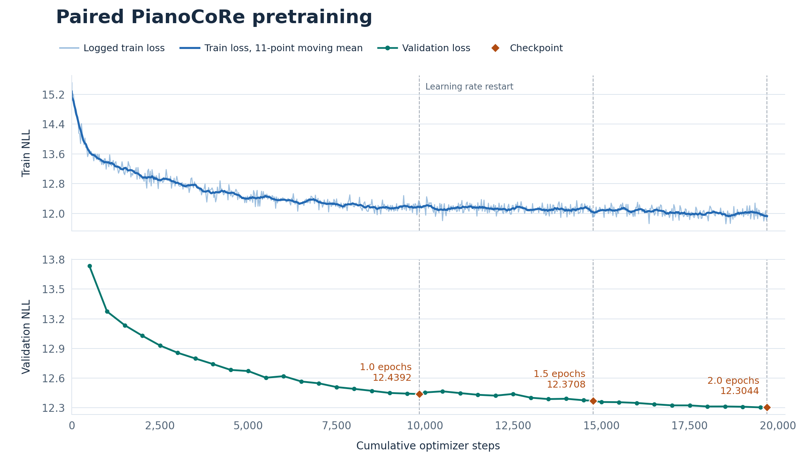
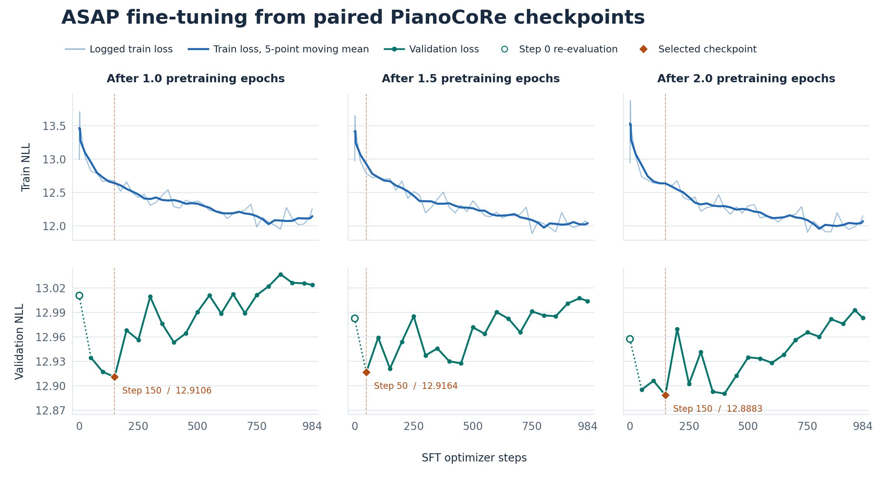

# Design1126 · PianoCoRe 预训练与 ASAP 微调

## 1. PianoCoRe-A 的 Chord 窗口

统计使用本地 PianoCoRe 的原始 Train/Test 划分，Tier A 包含 A*，并将与官方 ASAP 测试中相同的 32 份 PianoCoRe Train 演奏改计入 PianoCoRe Test。Train 有 1,780 个谱面路径和 141,678 份可用演奏，另有 9 份历史音高校验失败。Test 有 169 个谱面路径和 15,520 份演奏。按谱面起音 tick 和毫秒时长分组，每窗上限为 512 个 Chord，优先在小节边界切窗。每份演奏按其完整 refined 谱面布局计数。音符出现次数包括有插值对齐的谱面位置。有效演奏标签与最终跨语料核验留到 sidecar 构建时复核。相同作品的其他演奏仍可能出现在两个 split。 [Chord 分组与窗口口径](design1125.md#6-chord-与-pt2-窗口对比)

| PianoCoRe-A 划分 | 切窗 | 原窗 | 裁剪窗 | 总窗口 | 窗内 Chord 出现次数 | 每窗平均 Chord | 窗内音符出现次数 | 每窗平均音符 |
|---|---|---:|---:|---:|---:|---:|---:|---:|
| Train | 无重叠 | 481,471 | 0 | 481,471 | 210,173,665 | 436.52 | 330,194,144 | 685.80 |
| Test | 无重叠 | 68,629 | 0 | 68,629 | 31,624,017 | 460.80 | 47,502,794 | 692.17 |
| Train | 约 50% 重叠 | 762,824 | 0 | 762,824 | 367,048,719 | 481.17 | 572,604,316 | 750.64 |
| Test | 约 50% 重叠 | 115,881 | 0 | 115,881 | 56,921,767 | 491.21 | 84,822,410 | 731.98 |
| Train | 约 50% 重叠 + 裁剪 | 762,824 | 762,824 | 1,525,648 | 643,423,321 | 421.74 | 1,003,810,291 | 657.96 |
| Test | 约 50% 重叠 + 裁剪 | 115,881 | 115,881 | 231,762 | 99,876,671 | 430.94 | 148,863,679 | 642.31 |

表里的额外裁剪从起点与中点之间抽小节边界，保留原窗终点，使用可复现的种子。无重叠方案每个窗贪心装入完整小节并保留尾窗，超长小节用起音组边界。约 50% 重叠让 Train 增加 58.3% 的窗口和 74.6% 的 Chord 位置。再加裁剪后，Train 总 Chord 位置是无重叠的 3.06 倍。统计应用了明确的 split overlay，原始 PianoCoRe metadata 保持不变。 [调整后统计 JSON](../results/pianocore_chord_window_audit_asap_test_overlay/window_counts.json) · [演奏迁移清单](../results/pianocore_chord_window_audit/asap_overlap_split.json) · [复算脚本](../script/audit_pianocore_chord_windows.py)

## 2. PT 官方预训练如何切窗

核对 Pianist Transformer 公开仓库的 `5611e5c` 版本。README 的预处理入口先生成 Aria 和乐谱的 token 序列，经过切窗、Arrow 转换和合并，再由预训练入口读入。 [官方入口](../../results/pt_rendering_public_recipe_20261124/official_release/README.md#training-from-scratch) · [预处理脚本](https://github.com/yhj137/PianistTransformer/blob/5611e5c07dced23e8e82a380f210933ca9b65cf0/script/data_process.sh)

| 项目 | 公开脚本的实际做法 |
|---|---|
| 预训练重叠 | **0%**。在每个 map 批次内拼接 MIDI token，再以 **4,096 token** 为窗长和步长连续切分。按每音符 8 token 换算，一个满窗有 512 个音符。保留末尾短窗，单窗可能跨 MIDI 文件边界。 |
| 预训练裁剪 | **有，原位替换**。每个 map 批次随机选 `floor(窗数 × 0.1)` 个原窗。每个被选中的窗在窗内随机取长度和起点，两者都对齐到 8-token 音符边界，子窗直接替换原条目。总窗数保持不变。 |
| 数值扰动 | 公开预处理入口对 **Aria** 传入 `--enhanced`，在切窗前随机扰动 IOI、duration、velocity。Scores 分支按原 token 切窗。 |
| 训练目标 | 同一 MIDI 序列的自监督去噪。Encoder 输入随机遮盖 30% 的非 padding token，decoder 用右移的完整序列做 teacher forcing，交叉熵只计算遮盖位置。公开训练入口打乱已生成的窗，再按 98% / 2% 划分 train / valid。 |
| Rendering SFT | 官方配置的 overlap 为 **50%**。每个原窗追加一个对齐到音符边界的随机子窗，原窗和裁剪窗都进入数据集。 |

[预训练切窗和裁剪](https://github.com/yhj137/PianistTransformer/blob/5611e5c07dced23e8e82a380f210933ca9b65cf0/src/data_process/03_generate_pretrain_map_data.py#L14-L55) · [预训练配置](https://github.com/yhj137/PianistTransformer/blob/5611e5c07dced23e8e82a380f210933ca9b65cf0/configs/pretrain_config.json#L6) · [扰动实现](https://github.com/yhj137/PianistTransformer/blob/5611e5c07dced23e8e82a380f210933ca9b65cf0/src/utils/midi.py#L626) · [预训练目标与划分](https://github.com/yhj137/PianistTransformer/blob/5611e5c07dced23e8e82a380f210933ca9b65cf0/src/train/pretrain.py) · [SFT 配置](https://github.com/yhj137/PianistTransformer/blob/5611e5c07dced23e8e82a380f210933ca9b65cf0/configs/sft_config.json#L8) · [SFT 切窗与裁剪](https://github.com/yhj137/PianistTransformer/blob/5611e5c07dced23e8e82a380f210933ca9b65cf0/src/train/sft.py#L16-L58)

论文报告正式预训练为 **40,000 步**。公开最小复现配置的 `max_steps` 是 100,000，公开代码足以确认示例流水线的切窗和裁剪行为，发布权重的实际预处理比例仍以作者披露为限。 [论文 §3.3 与附录 A.3](https://arxiv.org/html/2512.02652v2) · [公开配置](https://github.com/yhj137/PianistTransformer/blob/5611e5c07dced23e8e82a380f210933ca9b65cf0/configs/pretrain_config.json#L19)

## 3. 三种预训练方案与首轮流程

固定 Chord AR、归一化 log 独立 MLP 128 和全字段单分量 DLM。保留 IOI 与 duration 的 500 桶 log dev、力度 128 桶、有效 IOI 掩码，以及自回归 top-p 采样。首轮采用 **0% 重叠、零额外裁剪**，以配对监督和原始对齐值为基线。三个方案共用无重叠原窗与按作品留出的验证集。控制训练步数和有效 Chord 数，并记录每种目标实际监督的字段数。 [模型与采样对照](design1125.md#892-第二批-dlm-结果)

| 方案 | Encoder 条件 | DLM 目标与监督位置 |
|---|---|---|
| **配对监督** | 对齐的原始 score Chord，包含音高集合与谱面数值。 | 预测 performance。IOI、duration 沿用相对 score 的 log dev，velocity 使用真人原值。对所有有效目标字段计算 NLL。优先使用合格的 Tier A 配对。 |
| **演奏遮盖补全** | 以同一份 performance 构造伪谱面输入，保留 Chord 布局和 pitch，随机遮盖演奏数值。首版对约 30% 的有效 Chord 同时遮盖 IOI、duration、velocity，用三种字段专属 mask embedding。按字段独立遮盖作为粒度对照。 | 还原干净 performance，只对被遮且有效的字段计 NLL。被遮的 timing 用训练集固定参考值作为 log dev 基准，Encoder 同一位置只看 mask embedding。真值只作为监督标签，三种方案继续共用 500 桶的相对 timing 输出。 |
| **随机扰动后还原** | 以同一份 performance 构造伪谱面输入，保留 pitch、Chord 布局和结构零。对有效正 timing 叠加小幅 log 扰动，力度加小幅整数扰动并限制在有效 MIDI 范围。首轮把扰动加在 Encoder 副本上，按窗动态抽取。 | 还原干净 performance。Timing 目标是干净值相对扰动输入的 log dev，velocity 目标是干净原值。对有效字段计算 NLL，另报被扰动位置的重建误差，检查恒等映射的影响。 |

**Teacher forcing 与历史 mask。** 三种方案的 Decoder 都只读右移的演奏历史，保留 BOS。Encoder 遮盖或数值扰动决定输入条件，Decoder 历史 mask 决定可见的过去演奏，有效标签掩码决定哪些位置计入 NLL。

| 阶段 | 首跑的 Decoder 历史设置 | 依据 |
|---|---|---|
| PianoCoRe 配对监督 | **50% 整组置零**。仅在训练时将抽中的上一 Chord 的 IOI、duration、velocity 合并反馈置零。 | 与 ASAP 微调和整曲 score → performance 任务共用历史反馈机制。1125 同架构的 ASAP 采样相关性支持采用这个起点。 |
| PianoCoRe 演奏遮盖补全 | **0% 历史 mask** 起步。Encoder 仍遮盖约 30% 的 Chord 数值。 | 先测定 Encoder 补全目标的迁移效果。右移真人历史可以提供上下文。若模型过度依赖这条历史，再对比 50% 整组置零。 |
| PianoCoRe 随机扰动后还原 | **0% 历史 mask** 起步。Encoder 仍接收扰动后的演奏数值。 | 先测定输入去噪目标的迁移效果。50% 历史 mask 作为额外对照，用于检验减少对干净历史的依赖是否能改善下游采样。 |
| ASAP 微调 | 三种初始化均采用 **50% 整组置零**。 | 固定下游历史策略，使下游结果可以比较预训练路线。 |

所有训练的验证 NLL 使用完整右移真人历史。自监督验证固定 Encoder 遮盖或扰动。整曲生成反馈模型自己的预测。1125 的 50% 结果来自 ASAP，PianoCoRe 上的最适比例仍待验证。若需要量化预训练阶段历史 mask 的独立贡献，用相同 PianoCoRe 子集、初始化与步数对比 0% 和 50%，接相同 ASAP 微调，并在 ASAP 训练侧留出的作品上比较整曲采样。若需要单独比较三类预训练目标，固定三组的历史 mask 策略。 [1125 采样 baseline](design1125.md#895-整曲采样-baseline)

补全与还原可以扩大到无谱面演奏，但首轮公平比较使用相同 Tier A 样本和 Chord 布局。自监督输入里只保留可在该流程取得的结构信息。扩大语料时，再单独验证无谱面情况下的 Chord 分组和有效标签覆盖。

1. **整理数据和划分。** 全量盘点 Tier A*、A、B 和其他条目，记录对齐可用性、重复项和排除原因。首轮监督使用全部合格的 Tier A 训练对。当前本地 Train 的 50,819 个仅 Tier B 条目缺少完整 refined 三件套，其中 3,123 条有原始对齐路径记录，需验证原始匹配后才能计入监督。发布的 PianoCoRe Test 留作域内评估。PianoCoRe 和 ASAP 的训练期验证各从自己的训练侧按作品留出。
2. **在生成 sidecar 前完成跨语料去重。** 保留官方 ASAP 23 个谱面路径作为最终测试。若 ASAP Test 演奏对应的 PianoCoRe 条目在 Train，就将该 PianoCoRe 条目按本节 overlay 计入 PianoCoRe Test，不排除其余 ASAP 训练演奏。其他来源若含同一测试演奏，也按音符指纹迁入 Test。ASAP 微调训练侧排除官方测试作品的等价谱面。应用迁移清单后重算训练窗口。 [ASAP 泄露核查](#4-asap-泄露核查)
3. **构建分片并验证标签。** 从 refined 谱面原 tick 建组，用 `perf_idx` 对齐演奏事件，核对归一化谱面音符顺序和来源身份。保留插值标记，统计每个字段的真实观测覆盖、IOI 非正值和 log dev 边界占比。检查跨对齐缺口的 IOI 掩码，再以磁盘分片和按批加载替代当前的全量张量上卡。
4. **先跑一轮 PianoCoRe。** 使用无重叠原窗、保留尾窗和零额外裁剪。GPU 0 跑配对监督，GPU 1 跑演奏遮盖补全，GPU 2 跑随机扰动还原。共用一份磁盘数据分片，各卡独立读取并按方案构造输入。每卡有效 batch 48，按当前 481,471 窗的上限估算，每条预训练约 10,031 步。留出 PianoCoRe Train 作品选权重，定期保存可恢复状态。
5. **ASAP 微调与端到端对照。** 从 PianoCoRe 权重继续训练，复用现有 ASAP 标签和 50% 整组置零，并用训练侧留出的作品选权重。对照同协议的 ASAP 随机初始化、PianoCoRe 直接推理和 PianoCoRe → ASAP 微调。在固定 23 首每首采样三次，对齐报告 §8.9.2 的九项指标。

配对监督基线保留原始 IOI、duration 和力度。对单音符独立加减时间可能改变同起音分组、结构零或相邻起音间隔。扰动还原先确定 Chord 布局再扰动输入字段，三种方案均以干净真人演奏为目标。

## 4. ASAP 泄露核查

本地 PianoCoRe 元数据中有 **1,066 条**演奏标注为 ASAP，其中 **978 条为 Tier A**，均有 refined 谱面、演奏和对齐文件。原划分中 Train 有 896 条 ASAP Tier A，Test 有 82 条。迁移清单应用后 Train 有 864 条、Test 有 114 条，其余 ASAP 记录保留原 split。 [PianoCoRe 元数据](../../backup/PianoCoRe/metadata.csv) · [迁移清单](../results/pianocore_chord_window_audit/asap_overlap_split.json)

将官方 ASAP 测试的 **101 份真人参考**与 PianoCoRe Tier A Train 按演奏文件名查找候选项。对同名原始 MIDI 比较音符事件并校正首音时间后，**32 份官方测试演奏**在音符数、音高和力度序列上精确对应，所有起音和结束时间的差值不超过 **2 ms**，涉及 **23 个测试谱面路径中的 13 个**。这 32 个 PianoCoRe performance row 直接从 Train 移到 Test overlay。 [ASAP 测试参考清单](../../results/pt_rendering_public_recipe_20261124/official_split_measure/reference_manifest.json) · [复算脚本](../script/audit_pianocore_asap_overlap.py)

该迁移处理了已确认的同一演奏跨 split 重合，没有排除 PianoCoRe 的其他 ASAP 演奏。13 个相关作品中其他演奏仍可能留在 Train，因此这个 PianoCoRe Test 衡量留出演奏表现，不等同于完全未见作品评估。作品级留出可以作为单独的泛化评估。

## 5. 三卡运行与时间估算

每张 RTX 3090 完整执行一条链路。先跑一轮 PianoCoRe 并用域内验证选权重，直接用该权重在 ASAP 上整曲预测和评分，再从同一权重做四轮预算的 ASAP SFT，最后用 SFT 权重重跑同一个测试。两次测试都以真实谱面为输入，共用 23 首测试谱面、101 份真人参考、每首 3 个采样种子，并可同时输出中位数。补全与扰动还原的预训练权重直接预测，衡量的是零样本迁移到谱面的能力。ASAP 的 SFT 权重由训练侧留出的作品选择。

| 阶段 | 每卡用时估计 |
|---|---:|
| PianoCoRe 预训练一轮，含验证、读盘和保存 | 2.1–2.8 小时 |
| 预训练权重整曲预测与评分 | 2–5 分钟 |
| ASAP SFT 四轮预算 | 12–18 分钟 |
| SFT 权重整曲预测与评分 | 2–5 分钟 |

三卡并行，数据与入口就绪后预计总墙钟 **约 2.4–3.3 小时**。1125 的同规格单卡实测约 0.73–0.77 秒每步，有效 batch 48，随机批补齐后几乎都是 512 Chord。约 10,031 步外推为 2.0–2.15 小时的训练基准，额外时间预算给新数据读取和验证。PianoCoRe Chord 分片构建与首次三卡冒烟的用时需要单独实测。 [单卡训练日志](../results/exp1125_chord_ar_mlp128_dlm_mask50/all_dlm_k1_mlp128_mask50/loss_history.jsonl)

当前 Train 窗口审计约 2.10 亿 Chord、3.30 亿展开音符，约为 1125 一轮 ASAP 的 36 倍。约 9,892 万参数对应每轮约 2.12 个训练 Chord 位置每参数。30% 遮盖补全预计直接监督约 6,305 万个 Chord 位置，实际字段数取决于有效标签覆盖。数据足以做首轮迁移比较。收益是否继续增长，由分阶段权重在相同 ASAP 协议下的整曲采样衡量。当前已具备原始数据、窗口审计和 ASAP 评分器。正式启动依赖新版 Chord 分片、训练侧验证划分、三种预训练目标和 SFT 权重载入路径的端到端冒烟。

### 5.1 实际启动

全量分片构建耗时约 10.6 分钟，覆盖 157,198 个唯一演奏 ID。应用 32 份录音的迁移清单和作品留出后，Train 有 138,990 份演奏、472,542 窗、206,287,977 个 Chord。Valid 有 2,688 份演奏和 8,929 窗，Test 有 15,520 份演奏和 68,629 窗。转换没有新增对齐失败。全为插值音符的 Chord 不监督时长和力度，IOI 只取相邻有真实起音的组。 [分片清单](../results/exp1126/data/manifest.json)

三条链路均完成短程预训练、直接预测评分、权重载入、SFT 和再次评分的冒烟验证。正式运行每卡 9,845 个预训练步，每 500 步及末步用固定 512 个 PianoCoRe Valid 窗验证，保存恢复状态，并按最低验证 NLL 导出权重。扰动还原使用标准差 0.1 的 log timing 噪声与标准差 4 的力度噪声，标准正态抽样截到 ±3 后应用。ASAP SFT 使用训练侧的 11,766 个训练窗和 1,862 个验证窗，四轮共 984 步。测试仍使用独立的 23 首 ASAP 谱面。 [ASAP 划分](../results/exp1126/asap_split.json) · [进程清单](../results/exp1126/runs/jobs.json) · [启动日志](../results/exp1126/launcher.log)

## 6. 整曲预测结果

三条链路于 11 月 26 日完成，从并行启动到汇总约 2 小时 11 分。三组预训练都在第 9,845 步取得最低域内验证 NLL。ASAP SFT 的最佳步数分别是配对监督 150、遮盖补全 600、扰动还原 650。已核对各 SFT 初始化权重与其预训练直出权重的 SHA-256 一致。

| 预训练方案 | 评估权重 | 小节 Tempo r ↑ | 小节 Vel r ↑ | Beat Tempo r ↑ | Beat Vel r ↑ | Onset-group Tempo r ↑ | Chord Vel r ↑ | IOI MAE (ms) ↓ | Duration MAE (ms) ↓ | Vel MAE ↓ |
|---|---|---:|---:|---:|---:|---:|---:|---:|---:|---:|
| 1125 ASAP-only baseline | ASAP | 0.274 | 0.476 | 0.201 | 0.440 | 0.100 | 0.416 | 59.30 | 120.03 | 11.00 |
| 配对监督 | 预训练直出 | 0.342 | 0.516 | 0.263 | 0.500 | 0.088 | 0.489 | 56.08 | 136.41 | 10.14 |
| **配对监督** | **SFT** | **0.333** | **0.513** | **0.251** | **0.493** | **0.145** | **0.485** | **54.10** | **102.57** | **9.68** |
| 遮盖补全 | 预训练直出 | 0.193 | 0.436 | 0.126 | 0.399 | 0.097 | 0.304 | 87.82 | 154.03 | 18.79 |
| 遮盖补全 | SFT | 0.312 | 0.482 | 0.257 | 0.460 | 0.106 | 0.460 | 57.02 | 115.01 | 10.02 |
| 扰动还原 | 预训练直出 | 0.087 | 0.439 | 0.055 | 0.392 | 0.036 | 0.330 | 58.46 | 131.02 | 21.79 |
| 扰动还原 | SFT | 0.309 | 0.449 | 0.224 | 0.424 | 0.101 | 0.417 | 63.21 | 127.86 | 11.42 |
| PT2 | ASAP | 0.346 | 0.479 | 0.266 | 0.463 | 0.130 | 0.473 | 57.02 | 118.15 | 9.06 |
| Human 留一 | 真人演奏（19 首） | 0.612 | 0.750 | 0.496 | 0.709 | 0.192 | 0.645 | 31.03 | 76.64 | 8.74 |
| Score MIDI | 原始谱面 | 0.313 | 0.489 | 0.222 | 0.438 | 0.067 | 0.353 | 58.42 | 130.74 | 22.42 |

模型行报告同一批 23 首谱面的整曲随机采样结果。Score MIDI 的速度相关和力度相关分别覆盖有方差的 6 首和 20 首。三种预训练方案与 1125 Chord baseline 使用相同的 69 个采样种子，统一复算九项指标。配对 SFT 在三条 SFT 路线中领跑八项，遮盖补全的 Beat Tempo r 最高。配对 SFT 的九项指标均优于历史 1125 baseline，时长 MAE 低 17.45 ms。配对直出的部分节奏和力度相关更高，SFT 将 onset-group Tempo r 从 0.088 提高到 0.145，并将时长 MAE 从 136.41 ms 降到 102.57 ms。

配对 SFT 的随机采样较同权重中位数提高小节 Tempo r 和 Beat Tempo r，并降低 IOI 和时长 MAE。中位数在三个粒度的力度相关、onset-group Tempo r 和力度 MAE 上更好。三条路线均使用一个训练 seed。1125 baseline 的训练与选权重划分和本轮不同，且配对预训练与两组自监督预训练的历史 mask 策略不同，因而两类比较衡量完整训练方案的表现。已移走已确认重复的 ASAP 测试演奏，PianoCoRe Train 仍可能含同一作品的其他演奏。 [完整指标与中位数](../results/exp1126/runs/baseline_comparison/multilevel_metrics.csv) · [逐曲目结果](../results/exp1126/runs/baseline_comparison/multilevel_metrics.json)

## 7. 配对预训练续训

从第 9,845 步恢复模型、AdamW 和随机数状态。已核对恢复文件内的权重与 §6 选中的配对预训练权重逐张量一致。第一轮学习率已降到 0，第二轮从 `1e-4` 线性衰减到 0。每卡有效 batch 48，沿用原来的非重叠窗口、50% Decoder 历史反馈置零和域内验证窗。累计 1.5 轮和 2 轮分别保存第 14,768 和 19,690 步的权重。

每个快照直接跑整曲预测，然后从同一快照完成四轮预算的 ASAP SFT。SFT 由同一批 ASAP 验证窗选权重。两种权重各在 23 首测试谱面生成一份中位数和三份随机采样，共用第一轮的采样种子并统一计算九项指标。 [续训配置](../results/exp1126/paired_continuation/runs/pretrain/run_config.json) · [续训日志](../results/exp1126/paired_continuation/runs/pretrain.log)

### 7.1 训练与验证 loss

PianoCoRe 的训练 loss 在第二轮继续缓慢下降。学习率重启后，验证 NLL 短暂回升，之后从第一轮末的 12.4392 降到第二轮末的 12.3044。深蓝训练线是 11 个日志点的居中滑动平均，浅蓝线是原始记录。 [首轮日志](../results/exp1126/runs/paired/pretrain/loss_history.jsonl) · [续训日志](../results/exp1126/paired_continuation/runs/pretrain/loss_history.jsonl)

三组 SFT 共用坐标尺度。深蓝训练线是 5 个日志点的居中滑动平均。空心点是从原始预训练权重出发，在相同的 1,862 个 ASAP 验证窗上补测的第 0 步。橙色菱形标的是整曲评估实际使用的 SFT 权重。 [第 0 步与最佳权重复测](../results/exp1126/paired_continuation/runs/sft_step0_validation.json) · [1.0 轮 SFT 日志](../results/exp1126/runs/paired/sft/loss_history.jsonl) · [1.5 轮 SFT 日志](../results/exp1126/paired_continuation/runs/epoch1p5/sft/loss_history.jsonl) · [2.0 轮 SFT 日志](../results/exp1126/paired_continuation/runs/epoch2/sft/loss_history.jsonl)

| 累计预训练轮数 | PianoCoRe 验证 NLL ↓ | ASAP 第 0 步 NLL ↓ | ASAP 最佳步数 | ASAP 最佳 NLL ↓ | ASAP 第 984 步 NLL ↓ |
|---:|---:|---:|---:|---:|---:|
| 1.0 | 12.4392 | 13.0109 | 150 | 12.9106 | 13.0236 |
| 1.5 | 12.3708 | 12.9830 | 50 | 12.9164 | 13.0039 |
| 2.0 | 12.3044 | 12.9573 | 150 | 12.8883 | 12.9831 |

三组 SFT 的训练 loss 整体下降，ASAP 验证 NLL 在前 50–150 步下降，随后波动回升，四轮结束时均高于各自第 0 步。训练时将 50% 的 Decoder 历史数值反馈整组置零，验证时使用完整的右移真人历史，因此应分别看两条曲线随步数的变化。整曲采样会把模型自己的采样结果送回 Decoder。2.0 轮初始化的早期 SFT 权重在真人历史条件下把验证 NLL 降低了 0.0690，但整曲采样的九项指标有八项退步，两种评估在这里给出了不同结果。

### 7.2 整曲采样

| 累计预训练轮数 | 整曲采样权重 | 小节 Tempo r ↑ | 小节 Vel r ↑ | Beat Tempo r ↑ | Beat Vel r ↑ | Onset-group Tempo r ↑ | Chord Vel r ↑ | IOI MAE (ms) ↓ | Duration MAE (ms) ↓ | Vel MAE ↓ |
|---:|---|---:|---:|---:|---:|---:|---:|---:|---:|---:|
| 1.0 | 预训练直出 | 0.342 | 0.516 | 0.263 | 0.500 | 0.088 | 0.489 | 56.08 | 136.41 | 10.14 |
| 1.5 | 预训练直出 | 0.345 | 0.544 | 0.269 | 0.521 | 0.093 | 0.507 | 53.58 | 134.61 | 9.77 |
| 2.0 | 预训练直出 | 0.429 | 0.551 | 0.337 | 0.536 | 0.118 | 0.521 | 53.91 | 120.30 | 8.98 |
| 1.0 | SFT | 0.333 | 0.513 | 0.251 | 0.493 | 0.145 | 0.485 | 54.10 | 102.57 | 9.68 |
| 1.5 | SFT | 0.324 | 0.491 | 0.269 | 0.475 | 0.152 | 0.475 | 71.11 | 121.24 | 10.06 |
| 2.0 | SFT | 0.371 | 0.536 | 0.290 | 0.514 | 0.143 | 0.509 | 76.53 | 151.62 | 10.84 |

从 1.0 到 2.0 轮，预训练直出的九项均值全部改善。按 23 首作品做配对 bootstrap，小节 Tempo r 提高 0.087，95% 区间为 0.031 至 0.166。时长 MAE 降低 16.11 ms，差值区间为 −34.38 至 −1.63 ms。

与各自的预训练直出相比，1.0、1.5、2.0 轮权重做 SFT 后，整曲采样分别有 4、2、1 项改善。1.0 轮改善起音组 Tempo r 和三项 MAE，1.5 轮改善起音组 Tempo r 和时长 MAE。2.0 轮只有起音组 Tempo r 改善，从 0.118 增至 0.143，另外五项相关下降，三项 MAE 上升。同一组 2.0 轮权重用中位数解码时，SFT 提高了六项相关中的五项，三项 MAE 仍上升。实验使用同一条续训轨迹和一个训练 seed。 [九项指标与中位数结果](../results/exp1126/paired_continuation/runs/multilevel_metrics.csv)

相比一轮 SFT，两轮 SFT 的拍级 Tempo r 和 Chord Vel r 上升，三项 MAE 都更高。Bach 前奏曲 BWV 885 的时长 MAE 增加约 917 ms，占两轮与一轮 SFT 总时长 MAE 差值的约 81%。23 首中有 18 首时长 MAE 上升。 [逐曲目明细](../results/exp1126/paired_continuation/runs/multilevel_metrics.json)
