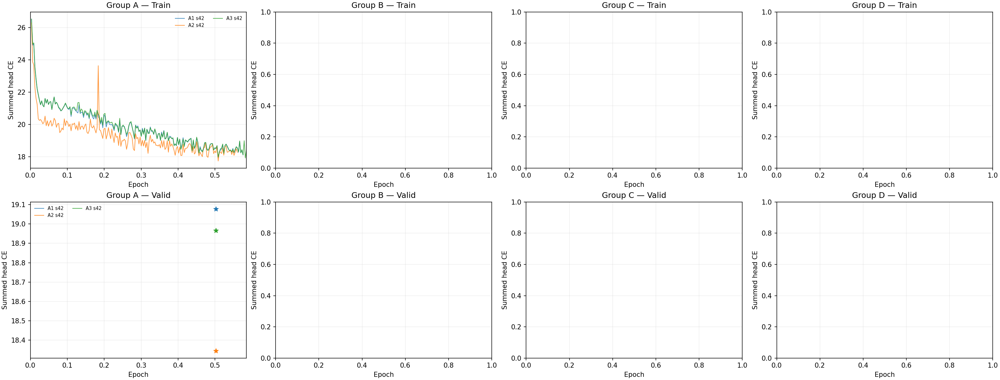

# exp1115：Beat / Note 双级时间表示实验

## 1. 协议与进度

[设计文档](design1115_beat.md)；[冻结数据审计](design1115_beat_data_audit.json)。A0 已有结果，不重跑。

更新时间：2026-11-16T01:21:22.787865+08:00。完整计划为 12 项设置 × 3 个训练种子 = 36 次训练；当前已建立 15 个任务，完成训练及 TF/AR 评估 0 个。后续配置按验证集依赖分阶段加入。

每次从随机权重开始；最大 16 epoch，每半 epoch 验证一次，patience=4（连续四次验证未改善停止），仅保留最低 valid CE 的 checkpoint。AdamW，起始学习率 3e-4，线性衰减，有效 batch=32（8×4）。decoder 训练时以 0.5 概率遮住整个历史事件向量，BOS/PAD 不遮；验证和生成关闭遮蔽。

每个设置使用三个独立训练种子，且每个最佳模型进行三轮采样（temperature=1、top-p=0.9）。表中先在每个训练种子内平均采样轮次，再对训练种子报告 mean ± sample std，保留三位小数；不足两个已完成训练种子时只展示数值与 n，不伪造标准差。CSV 另存各模型的采样标准差。

C/D 的自适应配置只使用 valid 贪心预测的物理误差：四项（beat duration log MAE、note duration log MAE、onset ratio MAE、velocity MAE/127）的均值，再跨三个训练种子平均；test 不参与选择。checkpoint 仍按总 valid CE 选择。

测试为 19 首作品、82 个参考演奏（以冻结审计为准）；其中两首 MS-score 沿用旧评估的 MUSICAL51 raw 标签兜底，其余使用 grouped-median 标签。HR 保留固定 human anchor，使用生成后按实际起音时间排序的 MIDI note-index W1；token JS / onset / duration 误差保留 score event 身份，二者不能视为同一个对齐协议。PP 报告原始 W1，不额外构造未校准的 PP HR。

生成分为不重叠的完整 beat 窗口（最多 512 note），窗口间延续累计 beat 时间，BOS 与 decoder cache 在窗口开始重置。AR 的独立窗口和三轮采样按固定任务顺序以 batch=16 解码，随机流由作品标识固定；原始 token/事件存 NPZ，MIDI 仅用于播放和 legacy 指标。

## 2. 分组训练与验证曲线

四列分别为 A/B/C/D，首行为细粒度 train CE，次行为半 epoch valid CE；星号标记各训练种子的最低 valid 点。每列横轴随该组实际最大 epoch 自动扩展。空列表示依赖尚未满足。



## 3. 结果表

| 设置 | beat target | note target | duration 输入表 | duration head | measure_start | 训练/评估 n | stop ep | best valid CE | valid 物理误差 | TF HR | AR HR |
|---|---|---|---|---|---|---|---|---|---|---|---|
| A1 | absolute_log | absolute_log | shared | separate | 1 | 0/0 | — | — | — | — | — |
| A2 | log_dev | log_dev | shared | separate | 1 | 0/0 | — | — | — | — | — |
| A3 | absolute_log | absolute_log | shared | separate | 0 | 0/0 | — | — | — | — | — |
| B1 | absolute_log | absolute_log | separate | separate | 1 | 0/0 | — | — | — | — | — |
| B2 | log_dev | log_dev | separate | separate | 1 | 0/0 | — | — | — | — | — |

### 3.1 Token 与物理误差

| 设置 | 解码 | beat JS | note dur JS | onset JS | velocity JS | beat log MAE | note dur log MAE | onset ratio MAE | beat anchor MAE (ms) |
|---|---|---|---|---|---|---|---|---|---|
| A1 | TF | — | — | — | — | — | — | — | — |
| A1 | AR | — | — | — | — | — | — | — | — |
| A2 | TF | — | — | — | — | — | — | — | — |
| A2 | AR | — | — | — | — | — | — | — | — |
| A3 | TF | — | — | — | — | — | — | — | — |
| A3 | AR | — | — | — | — | — | — | — | — |
| B1 | TF | — | — | — | — | — | — | — | — |
| B1 | AR | — | — | — | — | — | — | — | — |
| B2 | TF | — | — | — | — | — | — | — | — |
| B2 | AR | — | — | — | — | — | — | — | — |

### 3.2 MIDI PN / PP Wasserstein

| 设置 | 解码 | IOI PN W1 (ms) | duration PN W1 (ms) | velocity PN W1 | IOI PP W1 (ms) | duration PP W1 (ms) | velocity PP W1 |
|---|---|---|---|---|---|---|---|
| A1 | TF | — | — | — | — | — | — |
| A1 | AR | — | — | — | — | — | — |
| A2 | TF | — | — | — | — | — | — |
| A2 | AR | — | — | — | — | — | — |
| A3 | TF | — | — | — | — | — | — |
| A3 | AR | — | — | — | — | — | — |
| B1 | TF | — | — | — | — | — | — |
| B1 | AR | — | — | — | — | — | — |
| B2 | TF | — | — | — | — | — | — |
| B2 | AR | — | — | — | — | — | — |

[全部逐模型指标 CSV](../analysis/exp1115_beat/metrics.csv)。其中另含 accuracy、signed error、ratio MAE、各属性 HR 及模型内的采样标准差。

## 4. 当前运行与自动依赖决策

- GPU0：`A1_seed42`，training，子进程 PID 2356189。
- GPU1：`A2_seed42`，training，子进程 PID 2356190。
- GPU2：`A3_seed42`，training，子进程 PID 2356191。

## 5. 可恢复队列

队列入口：[`script/run_dinr_beat_queue.py`](../script/run_dinr_beat_queue.py)。每张卡一次一个任务；训练后依次验证、TF/AR 测试、保存指标和刷新图表。OOM 时减小 microbatch 并保持有效 batch=32；评估失败可从已完成作品恢复。失败会明确记入 manifest，依赖阶段停止，不把缺失实验当成完成。

运行目录：`/home/kaititech/EPR/PianistTransformer/results/exp1115_beat`。此目录保存 manifest、每任务日志、best checkpoint、sidecar hashes、原始 token、MIDI 和逐作品指标。

```bash
cd INSPIRE2
python script/run_dinr_beat_queue.py --gpus 0 1 2
```
